<h1 align="center">Timeseeker</h1>

  <strong>@TimeseekerKK</strong> 
  Full-stack · Desktop · Embedded UI · Flutter · Automation

  
  
  

<em>Build, document, reuse.</em>

  <a href="#about">About</a> · <a href="#toolbox">Toolbox</a> · <a href="#projects">Projects</a> · <a href="#contributions">Contributions</a>

## About

I build practical tools across platforms.

- **Web** · Full-stack dashboards
- **Desktop** · Windows tools with Python & Qt
- **Embedded** · GUI and firmware
- **Mobile & automation** · Flutter apps and Python workflows

<!-- 统计所有自有仓库（含 fork、私有仓库）现存分支中属于 TimeseekerKK 的作者提交；包含 merge，跨仓库按 SHA 去重。
合并当前用户名与已核实的历史作者邮箱查询，以 GitHub 账户 ID 校验归属；未关联账户的提交仅接受已核实邮箱。
历史邮箱：149032340+TobeBestKK@users.noreply.github.com。用户名更改不影响其计入；不将旧总数与新总数直接相加。
首次启用：在本仓库 Actions secrets 中配置 COMMIT_STATS_TOKEN；使用 TimeseekerKK 的 Classic PAT，授予 repo 和 read:user。
工作流需要读取 owned_private_repos 来核验私有仓库覆盖范围；读取失败时保留旧卡片，不发布部分结果。
提交数减少至少 10 条且降幅超过 20% 时保留旧卡片并报错；核实仓库或分支变动后，可手动运行工作流并选择 allow_decrease。
卡片内的 Total Commits 使用上述计数，其余统计和等级来自 github-stats-extended；首次完整统计前 Total Commits 显示 pending。
卡片底部使用与统计文字一致的粗体显示 Last synced（UTC+8，北京时间）；每次成功运行都会更新时间，即使统计数值未变。同步失败时保留上次卡片与时间。 -->

 

## Toolbox

| Area | Technologies |
| :--- | :--- |
| **Web** | `Vue 3` · `TypeScript` · `Spring Boot` · `MySQL` |
| **Desktop** | `Python` · `PySide6 / Qt` · `Windows API (ctypes)` |
| **Mobile** | `Flutter` · `Dart` |
| **Embedded** | `C` · `AT32F435/437` · `LVGL` · `Keil MDK` |
| **Automation** | `Python` |
| **Build & CI** | `PyInstaller` · `PowerShell` · `unittest` · `GitHub Actions` |

Flutter prototypes with local state & REST APIs · Python image-recognition automation & contributions.

## Projects

| Project | Focus | Description |
| :--- | :--- | :--- |
| **[ValorantToxicTamer](https://github.com/TimeseekerKK/ValorantToxicTamer)** | Desktop | Windows tray messaging, hotkeys & auto-updates |
| **[student-score-admin-system](https://github.com/TimeseekerKK/student-score-admin-system)** | Dashboard | Student score administration |
| **[suiwuyou-project](https://github.com/TimeseekerKK/suiwuyou-project)** | Mobile | Flutter app project |
| **[14-AT32-LVGL-Nos-template](https://github.com/TimeseekerKK/14-AT32-LVGL-Nos-template)** | Embedded UI | AT32 + LVGL template |
| **[Airclean_board](https://github.com/TimeseekerKK/Airclean_board)** | Firmware | Board firmware |
| **[Share-Experience-For-Github.edu](https://github.com/TimeseekerKK/Share-Experience-For-Github.edu)** | Docs | GitHub notes & experience |

## Contributions

  <picture>
    <source media="(prefers-color-scheme: dark)" srcset="./github-contribution-grid-snake-dark.svg">
    <source media="(prefers-color-scheme: light)" srcset="./github-contribution-grid-snake.svg">
    
  </picture>

  <a href="https://github.com/TimeseekerKK">GitHub</a> · <a href="https://gitee.com/Timeseeker">Gitee</a> · UTC+8 · <a href="#timeseeker">Back to top ↑</a>

